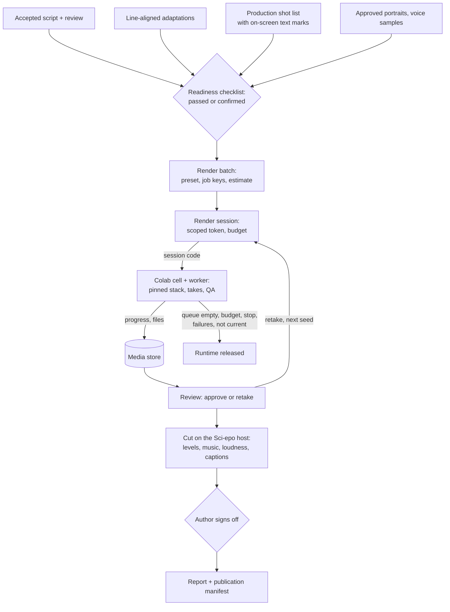
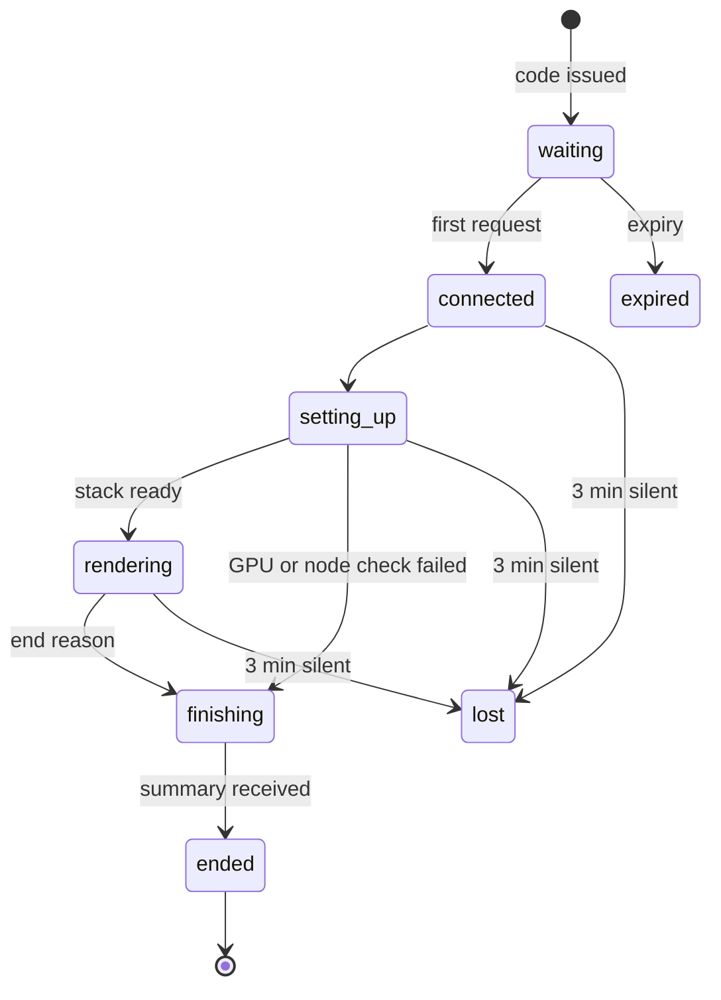

# Design Document

Status: proposed.

## Overview

Sci-epo plans and keeps the record; workers render. The H3 bridge stops at "a job has a file name and a status". This design carries an episode from its accepted script to a delivered cut in seven stages, each with a gate the author can see:

| Stage | The author | Sci-epo keeps | Gate to the next stage |
|---|---|---|---|
| 1 Script | accepts a revision, runs a review | revision, review | readiness checklist |
| 2 Languages | adapts line by line | bound adaptations | readiness checklist |
| 3 Shot list | adopts it, marks on-screen text | production shot list | readiness checklist |
| 4 Cast | approves portraits and voice samples | references with SHA-256 | readiness checklist |
| 5 Render | creates a batch, starts a session, pastes the code into Colab | jobs, takes, QA | every job has a rendered take |
| 6 Review | approves or retakes each job | verdicts | every job approved |
| 7 Cut and delivery | picks music, checks captions, signs off | cuts, report, manifest | sign-off |



Rules that hold throughout:

- **Frozen inputs, keyed renders.** A batch freezes its inputs. A job key names a render, and a take records a seed and a file. A fix re-renders only the jobs whose key changed.
- **The runtime is disposable.** Every file a worker makes reaches the media store before the worker ends, so releasing the runtime loses nothing.
- **No GPU time without an end.** A session has a budget, a stop control and an automatic release, and it ends on repeated failure.
- **The author decides, and the decision is kept.** Confirmed readiness items, approvals, retake reasons and sign-offs are stored and appear in the report.

## What the first real run showed

| Finding | Response |
|---|---|
| The script reached the GPU without a review. An off-screen character knew what she could not know, the ending's prop appeared in the last line, and the father-daughter relationship was never stated. | Readiness checklist (R1.1–R1.4); new review checks with the draft as a fixture (R1.7, R1.8) |
| Portraits were made outside Sci-epo; one had a hood the description lacked, and a clip copied it. | Portraits in Sci-epo, approved next to the appearance text (R3) |
| A hand-written cell pinned ComfyUI, downloaded models, supplied the workflow and references, and wrote a status file. | Stack profiles and one session cell (R5) |
| The runtime had to be stopped by hand. | Budget, stop control, automatic release (R6) |
| Two of twelve planned renders were duplicates (clips without dialogue) and were removed by hand. | Job keys (R4.3) |
| One shot was rotated by 90° in both languages, which share a seed. | Takes, retakes, carry-over (R4.4–R4.6) |
| The author could not find the files, and nothing joined the clips. | Media store (R2), review (R8), cuts (R9) |
| Music was faint or absent; clip loudness ranged from −28.3 to −10.5 LUFS. | Music bed and loudness at the cut (R4.2, R9.4) |
| Phone text was partly garbled and English in the Chinese episode; a 24-word note had 4.5 seconds. | On-screen text marks, a readability warning, captions (R1.5, R1.6, R9.6) |
| Contact sheets, loudness, speech recognition and the report were done by hand. | Per-take QA (R7), report (R10) |

Measured on that run (G4 runtime with an RTX PRO 6000 Blackwell, 96 GB; H3 LITE R2V; 480×864; 20 steps): the pinned stack was set up in 204 s; 10 renders of 3,161 frames took 32.6 minutes, 0.62 s per frame; the runtime used about 7 compute units at 10.05 per hour. These numbers are the default estimate.

## Readiness

`src/core/readiness.ts` computes the items from the bundle, the episode, the production shot list and the chosen languages:

| Item | Passed when | Otherwise |
|---|---|---|
| `accepted` | the episode has an accepted revision and needs no recheck | failed |
| `review` | the newest review of the accepted revision is live and has no errors | failed |
| `issue:<target>` | — | warning, one per open issue |
| `adaptation:<language>` | a line-aligned adaptation of the accepted revision is bound | failed |
| `shot_list` | the production shot list is current | failed |
| `shot_warning:<kind>:<shot>` | — | warning, one per shot-list warning |
| `appearance:<name>`, `voice:<name>` | the profile describes the character | warning |
| `portrait:<name>` | the character uses no portrait, or has an approved one | failed |

The batch form lists the items. One confirmation names every item that did not pass. `POST /api/shot-lists/:id/render-batches` takes `confirmedReadiness: string[]`, recomputes the items, and answers 409 when an item that did not pass is missing from the list. The batch stores the `ReadinessRecord`.

**On-screen text.** `Shot.screenText?: number[]` holds line positions inside the shot, so the shot list still copies no script text. The storyboard prompt asks the model to list the lines that show readable text on a phone, note, sign or document, and `parseShot` checks that each position lies in the shot. The shot editor has a toggle per line. The text that is measured and captioned is the quoted part of the line (`“…”`, `"…"`, `「…」`, `'…'`), or the line without a speaker label when it has no quote. `screen_text_unreadable` compares characters divided by the reading speed with the shot's duration, for every voice language.

**Review rules.** The five checks of R1.7 go into `SHORT_DRAMA_REVIEW_RULES`, under story, continuity and filmability. Episodic prompts do not change, so `tests/fixtures/episodic-prompts.json` stays as it is. `examples/last-order-draft.json` is a hand-written draft with the same kinds of problems and an `expected_findings` list; the generated draft stays outside the repository. `scripts/review-fixture.ts --run` reviews the fixture with the live model and prints the findings it raised and missed. A missed finding is reported, not failed, because a model review is not deterministic.

## Data model

```ts
// Readiness: computed for the batch form, stored with the batch as confirmed.
export interface ReadinessItem { id: string; status: 'passed' | 'warning' | 'failed'; message: string; link: {tab: 'script' | 'review' | 'languages' | 'shots' | 'production'; target?: string} }
export interface ReadinessRecord { items: ReadinessItem[]; confirmed: string[]; confirmedAt?: string }

// Shot: line positions that show on-screen text. The text stays in the script.
export interface Shot { /* existing fields */ screenText?: number[] }

// Media store
export type MediaKind = 'reference_image' | 'voice_sample' | 'music' | 'take_video' | 'qa_image' | 'qa_data' | 'cut_video' | 'report';
export interface MediaAsset { id: string; projectId: string; kind: MediaKind; contentType: string; bytes: number; sha256: string; origin: 'owner' | 'worker' | 'sciepo'; sessionId?: string; label?: string; license?: string; createdAt: string }
export interface AssetRef { assetId: string; sha256: string }

// Cast
export interface ProductionCharacter { /* existing fields */ usePortrait?: boolean; portraitPrompt?: string; portrait?: AssetRef & {approvedAt: string}; voiceSampleAsset?: AssetRef }
export interface PortraitJob { id: string; projectId: string; character: string; prompt: string; stack: StackRef; takes: Take[]; createdAt: string }

// Render plan v2. Batches and jobs made before v2 keep their shape and stay readable.
export interface StackRef { id: string; version: string }
export interface RenderPreset { width: number; height: number; steps: number; turbo: boolean; stack: StackRef }
export interface BatchReference extends AssetRef { name: string; kind: 'image' | 'audio' }
export interface RenderBatch { /* existing fields */ version?: 2; preset?: RenderPreset; musicMode?: 'bed' | 'native'; references?: BatchReference[]; readiness?: ReadinessRecord }
export interface RenderClip { /* existing fields */ pictureKey?: string }
export interface RenderJobV2 { version: 2; id: string; batchId: string; clipId: string; key: string; languages: string[]; order: number; outputName: string; takes: Take[]; approvedTake?: number; updatedAt: string }

export type RetakeReason = 'picture_broken' | 'character_drift' | 'line_wrong' | 'lip_sync' | 'garbled_text' | 'other';
export interface Take {
  n: number; seed: number; status: 'queued' | 'claimed' | 'rendered' | 'failed';
  sessionId?: string; leaseExpiresAt?: string; startedAt?: string; finishedAt?: string; renderSeconds?: number;
  video?: AssetRef & {bytes: number; seconds: number}; qa?: TakeQa;
  verdict?: {decision: 'approved' | 'retake'; reasons: RetakeReason[]; note?: string; at: string};
  carriedFrom?: {batchId: string; jobId: string; take: number}; rehearsal?: boolean; error?: string;
}
export interface QaCheck { id: 'duration' | 'size' | 'frame_rate' | 'audio' | 'loudness' | 'silence' | 'line'; status: 'pass' | 'warning' | 'failure'; message: string; value?: number }
export interface TakeQa {
  checks: QaCheck[]; loudness: {integrated: number; truePeak: number; range: number};
  contactSheet?: string; keyframes: {shotId: string; assetId: string}[]; dataAssetId?: string;
  speech?: {language: string; segments: {start: number; end: number; text: string}[]; lines: {sceneId: string; position: number; expected: string; heard: string; score: number}[]};
}

// Sessions
export type SessionEnd = 'queue_empty' | 'budget' | 'stopped' | 'not_current' | 'failures' | 'error' | 'lost' | 'expired';
export interface RenderSession {
  id: string; projectId: string; batchIds: string[]; portraitJobIds: string[]; mode: 'pull' | 'offline' | 'rehearsal';
  tokenHash: string; status: 'waiting' | 'connected' | 'setting_up' | 'rendering' | 'finishing' | 'ended' | 'lost' | 'expired';
  settings: {budgetMinutes: number; allowUntestedGpu: boolean; waitForRetakesMinutes: number};
  createdAt: string; expiresAt: string; lastSeenAt?: string; startedAt?: string; endedAt?: string; end?: SessionEnd;
  worker?: {gpu: string; vramGb: number; workerSha256: string; comfyCommit?: string};
  events: {at: string; stage: string; message?: string; data?: Record<string, number | string>}[];
  stopRequest?: {when: 'after_take' | 'now'; at: string};
  summary?: {minutes: number; computeUnits?: number; takesRendered: number; takesFailed: number; undelivered: number};
  readings?: {before?: number; after?: number};
}
export interface RenderRate { stack: string; version: string; width: number; height: number; steps: number; turbo: boolean; gpu: string; secondsPerFrame: number; samples: number; updatedAt: string }

// Cuts
export interface CutSettings { music: {assetId: string; levelDb: number} | null; dialogueLufs: number; ambienceLufs: number; maxGainDb: number; targetLufs: number; truePeakDb: number; fadeMs: number; size: 'native' | '720x1280' | '1080x1920' | '1280x720' | '1920x1080' }
export interface Caption { shotId: string; start: number; end: number; text: string; position: 'bottom' | 'top'; enabled: boolean }
export interface Cut {
  id: string; batchId: string; language: string; kind: 'draft' | 'final';
  takes: {jobId: string; take: number; sha256: string}[]; settings: CutSettings; captions: Caption[];
  status: 'queued' | 'running' | 'done' | 'failed'; output?: AssetRef & {seconds: number; loudness: number; truePeak: number};
  signOff?: {decision: 'signed_off' | 'rejected'; note?: string; at: string}; rehearsal?: boolean; error?: string; createdAt: string; updatedAt: string;
}

// Project settings outside the frozen brief
export interface Project { /* existing fields */ productionSettings?: {computeUnitsPerHour?: number; readingSpeed?: {latin: number; cjk: number}; cutDefaults?: Partial<CutSettings>} }
```

New tables: `media_assets`, `portrait_jobs`, `render_sessions`, `render_rates` and `cuts`. `Store.update` gains `portrait_jobs`, `render_sessions`, `render_rates` and `cuts`. Batches stay insert-only. Defaults for `CutSettings`: dialogue −16 LUFS, no dialogue −22 LUFS, gain ±9 dB, target −14 LUFS, true peak −1 dBTP, fades 20 ms, music −20 dB.

## Render plan v2

`planRenderBatch` keeps its prompt building. After it builds the prompt of every language for a clip:

1. **Picture key**: SHA-256 of a canonical JSON of the shot IDs, the mode, the prompt with the inside of every `<d>…</d>` removed, the frames, the preset and the reference hashes. Language prompts differ only inside `<d>`, so all languages of a clip share it.
2. **Job key**: SHA-256 of the picture key and the full prompt.
3. **Grouping**: jobs are grouped by key. A clip without dialogue yields one job with every language, named `ep01-c01.mp4`; other jobs keep `ep01-c02-zh-CN.mp4`.
4. **Seeds**: take n uses FNV-1a of `pictureKey:n`. v1 batches keep the batch-and-clip rule.
5. **Music**: with `musicMode: 'bed'`, `non_diegetic_music` is `N/A` in every prompt; the profile's music description is used only in `native` mode.
6. **Carry-over**: the planner returns, for each job, earlier jobs of the episode with the same key and an approved take. The batch form lists them, checked by default. Each entry of `carryOver: string[]` becomes take 1 with `carriedFrom` and the approved verdict.

**Estimate**: setup minutes of each stack used, plus the frames of each take times the seconds per frame, plus 15 s per take for QA and upload. The rate is the median of measured takes in `render_rates` for the stack, version, size, steps, turbo switch and GPU. Without a measurement, the stack's default rate is scaled by pixel count and the estimate is labelled as a default. The server updates the rate after each rendered take. Compute units are minutes / 60 × `computeUnitsPerHour`, shown only when that rate is set.

## Render sessions

Owner endpoints:

| Method and path | Purpose |
|---|---|
| `POST /api/projects/:id/render-sessions` | create with batch IDs, portrait job IDs, mode, budget and options; returns the session and the code once |
| `POST /api/render-sessions/:id/code` | reissue the code while no worker has connected |
| `GET /api/render-sessions/:id` | status, events and summary, polled every 5 s while the session runs |
| `POST /api/render-sessions/:id/stop` | `{when: 'after_take' \| 'now'}` |
| `POST /api/render-sessions/:id/readings` | compute units read before and after |

Worker endpoints, with `Authorization: Bearer sciepo_ss_…`:

| Method and path | Purpose |
|---|---|
| `GET /api/worker/v1/session` | the session document: settings, stack profiles with workflows, references, job counts, estimate, worker SHA-256 |
| `GET /api/worker/v1/session/worker.py` | the worker program of this server |
| `GET /api/worker/v1/references/:sha256` | one reference of the session's batches |
| `POST /api/worker/v1/session/events` | stage events |
| `POST /api/worker/v1/session/claim` | the next take, `{wait: seconds}` or `{end: reason}` |
| `POST /api/worker/v1/takes/:job/:n/heartbeat` | extends the 15-minute lease; returns `{stop, current, budgetEndsAt}` |
| `PUT /api/worker/v1/takes/:job/:n/files/:kind` | raw upload of `video`, `contact-sheet`, `keyframe?shot=` or `qa` |
| `POST /api/worker/v1/takes/:job/:n/result` | `rendered` or `failed`, QA summary, file hashes, timing |
| `POST /api/worker/v1/session/end` | reason and summary; revokes the token |

Session tokens have the prefix `sciepo_ss_` and the same 32-byte random form as worker tokens. A session token never opens the v1 worker endpoints, and a worker token never opens session endpoints. A claimed take carries its prompt, frames, size, steps, turbo switch, seed, reference names, output name, the shot start and end times (for contact sheets and keyframes), and the expected lines with their scene and position (for speech matching).



**Claim order**: portrait takes first, then queued takes in batch order and job order, retakes included. The server answers `{end: 'budget'}` when now plus the expected take time passes the budget, `{end: 'not_current'}` when a batch is no longer current, `{end: 'stopped'}` after a stop, and `{end: 'queue_empty'}` otherwise. With `waitForRetakesMinutes`, it answers `{wait: 30}` until that many minutes have passed since the last take.

**Liveness**: heartbeats every 30 s during a take; events at every stage and every 15 s during downloads. Every request updates `lastSeenAt`. Reading a session whose `lastSeenAt` is more than 3 minutes old marks it lost. A take claimed by a lost or ended session becomes claimable when its lease ends.

**End**: the worker reports undelivered takes, and the server queues them again with the same take number and seed, because nothing of them reached Sci-epo. The token is then revoked, and later requests with it get 401.

**Sci-epo on the author's computer**: Colab cannot reach `127.0.0.1`. With `SCIEPO_WORKER_PORT` set, the server opens a second listener that answers only `/api/worker/v1/*` (any other path is 404, and the host check does not apply there because only token endpoints exist). A quick tunnel to that port (`cloudflared tunnel --url http://127.0.0.1:4318`) gives an `https` address; with `SCIEPO_WORKER_PUBLIC_URL` set to it, session codes carry that address. The owner interface stays on `127.0.0.1` and is never tunnelled. Offline session packages, for runtimes with no network path to Sci-epo, are later work.

## Worker

`python sciepo_worker.py session` reads the code from `SCIEPO_SESSION`. The program stays one file with a standard-library core; the session installs optional packages into the runtime and imports them only when needed.

1. **Session document**. Rehearsal skips steps 2–4.
2. **GPU check**: `nvidia-smi --query-gpu=name,memory.total` against the `testedGpus` of every stack in use.
3. **Setup**: clone ComfyUI at the stack's commit, install its requirements and `huggingface_hub[hf_transfer]`, download the stack's files with `snapshot_download(allow_patterns=…)` and `HF_XET_HIGH_PERFORMANCE=1`, and report the bytes in the target folder every 15 s. ComfyUI starts once, on 127.0.0.1:8188.
4. **Node check**: `/object_info` must list every class in `requiredNodes`.
5. **References**: download, verify SHA-256, write to the refs folder.
6. **Loop**: claim, render with the existing ComfyUI backend (steps and turbo from the take, seed from the take), run QA, upload with exponential back-off for at most 10 minutes in all, and post the result. A heartbeat thread runs during each take; on `stop: 'now'` it posts ComfyUI's `/interrupt`. Two failed takes in a row end the session.
7. **End**: report undelivered takes, post the summary, and exit with 0 after a normal end or 3 after an error.

Stack profiles live in `worker/stacks/`:

```json
{
  "id": "h3-lite-r2v", "version": "2026.11.1",
  "comfyui": {"repo": "https://github.com/Comfy-Org/ComfyUI.git", "commit": "fca60fe70e5b84c5c6b058263653d15cb3401e44"},
  "files": [
    {"repo": "Comfy-Org/MiniMax-H3", "path": "diffusion_models/minimax_h3_ref2va_pruned_int8_convrot.safetensors"},
    {"repo": "Comfy-Org/MiniMax-H3", "path": "text_encoders/qwen3vl_32b_minimax_h3_nvfp4_awq.safetensors"},
    {"repo": "Comfy-Org/MiniMax-H3", "path": "vae/minimax_h3_video_vae_int8_convrot.safetensors"},
    {"repo": "Comfy-Org/MiniMax-H3", "path": "vae/minimax_h3_audio_vae_fp32.safetensors"},
    {"repo": "Comfy-Org/MiniMax-H3", "path": "loras/minimax_h3_ref2v_turbo_4step_v0.1_comfyui_bf16.safetensors"}
  ],
  "requiredNodes": ["UNETLoader", "CLIPLoader", "VAELoader", "LoraLoaderModelOnly", "LoadImage", "LoadAudio", "MiniMaxH3ReferenceToVideo", "BasicGuider", "RandomNoise", "KSamplerSelect", "BasicScheduler", "SamplerCustomAdvanced", "VAEDecode", "VAEDecodeAudio", "CreateVideo", "SaveVideo"],
  "testedGpus": [{"name": "RTX PRO 6000 Blackwell", "minVramGb": 90, "colabRuntime": "G4"}],
  "workflow": "h3-lite-r2v.workflow.json",
  "setupMinutes": 4,
  "defaultSecondsPerFrame": {"480x864": 0.62}
}
```

`h3-lite-t2va` uses the fl2va model with its turbo LoRA and lists no tested GPU yet, so it needs the author's override until a live run. `sdxl-portrait` uses `stabilityai/stable-diffusion-xl-base-1.0`, 768×1344, 28 steps, and the six nodes `CheckpointLoaderSimple`, `CLIPTextEncode`, `EmptyLatentImage`, `KSampler`, `VAEDecode` and `SaveImage`; it ran on G4 in the first run. Workflows are written for Sci-epo against the node definitions at the pinned commit, not copied from the official templates. `prepare-workflow` stays for workflows the author brings.

**QA**: ffprobe for duration, size, frame rate and streams; `ebur128` for loudness and true peak; `silencedetect` at −45 dB for 2 s; a contact sheet with one frame per second, 180 pixels wide, eight across, with shot labels drawn from text files; a keyframe in the middle of each shot; JPEG files. Speech: `faster-whisper` with `large-v3-turbo` on CUDA, installed only when the session has takes with dialogue. For each expected line, the score is the best similarity over contiguous recognized segments, after normalizing case, punctuation and character width, counting characters for Chinese and Japanese and words otherwise.

**Rehearsal**: ffmpeg `testsrc2` and `sine` for the planned frames, with the expected lines drawn from text files. QA runs as usual.

**Logs**: every line the worker sends to Sci-epo has `sciepo_(ss|wk)_[A-Za-z0-9_-]{43}` replaced by `[token]`.

## Colab notebook

`worker/colab/sciepo_session.ipynb` has one cell. The old notebook stays as the advanced path for worker tokens and the v1 modes.

```python
#@title Sci-epo render session · 渲染会话
KEEP_RUNTIME = False  #@param {type:"boolean"}
import getpass, hashlib, json, os, subprocess, sys, urllib.request
from google.colab import runtime

def fetch(url, token):
    request = urllib.request.Request(url, headers={'authorization': f'Bearer {token}'})
    with urllib.request.urlopen(request, timeout=60) as response:
        return response.read()

process = None
try:
    code = getpass.getpass('Session code 会话码: ').strip()
    server, _, token = code.partition('#')
    session = json.loads(fetch(server + '/api/worker/v1/session', token))
    program = fetch(server + '/api/worker/v1/session/worker.py', token)
    if hashlib.sha256(program).hexdigest() != session['worker']['sha256']:
        raise SystemExit('The worker program does not match the server; it was not run.')
    open('/content/sciepo_worker.py', 'wb').write(program)
    process = subprocess.Popen([sys.executable, '/content/sciepo_worker.py', 'session'], env=dict(os.environ, SCIEPO_SESSION=code),
                               stdout=subprocess.PIPE, stderr=subprocess.STDOUT, text=True)
    for line in process.stdout:
        print(line, end='')
finally:
    if process and process.poll() is None:
        process.terminate()
    if not KEEP_RUNTIME:
        runtime.unassign()
```

`runtime.unassign()` asks Colab's runtime service to unassign the VM and then disconnects the notebook. The cell calls it in `finally`, so it also runs after an error or a manual interrupt. Whether a cell keeps running after the browser tab closes depends on the Colab plan, so the session page tells the author to keep the tab open unless the plan has background execution.

## Media store

- **Layout**: `<SCIEPO_MEDIA_DIR>/<first two hex digits>/<sha256>`. A record in `media_assets` per project and hash; the same file uploaded twice is stored once.
- **Uploads**: owners use `PUT /api/projects/:id/media?kind=&label=&license=` with a raw body and the CSRF token. This route and the worker file routes are exempt from the JSON-only rule and the 250,000-character limit. The body is streamed to a temporary file with the kind's limit, hashed, checked and moved.
- **Signatures**: PNG `89 50 4E 47`; JPEG `FF D8 FF`; WebP `RIFF….WEBP`; MP4 and M4A an `ftyp` box; WAV `RIFF….WAVE`; MP3 `ID3` or a frame sync; FLAC `fLaC`; JSON must parse; Markdown must be UTF-8.
- **Serving**: `GET /api/media/:id` for the owner, with the stored content type, `nosniff`, `Content-Disposition: inline` for images and video and `attachment` for reports, and 206 responses for `Range` requests. The current CSP already allows same-origin media.
- **Quota and deletion**: usage is the sum of stored bytes per server. Deletion refuses media used by an approved take, a signed-off cut, an approved reference or a report.
- **Operations**: the media folder is backed up with the database, and a reverse proxy needs a request body limit above 64 MB on the worker file routes and 30 MB on the owner upload route.

Size, from the first run at 480×864: an episode with both languages, every take and both cuts is about 60 MB.

## QA and review

The production tab shows the batch as a grid of clips by language. A cell shows the latest take's status, a thumbnail and its worst check. Opening a job shows:

- the video (`<video controls playsinline>` from the media store);
- the contact sheet with shot labels, and the keyframes;
- the checks, with values;
- the expected lines next to the recognized text, with scores;
- earlier takes, with their verdicts and reasons;
- actions: approve this take, retake with reasons and a note, open the shot in the shot editor.

Counts on the batch keep "rendered / checks failed" apart from "approved / retakes asked".

## Cuts

`src/core/cut.ts` is pure: it builds the cut list, gains, captions and ffmpeg arguments. `src/server/cuts.ts` runs one cut at a time with `Bun.spawn` and an argument array, never a shell. Running cuts return to queued after a restart, as interrupted runs do today.

1. **Inputs**: the takes' videos from the media store, with their hashes checked.
2. **Gains**: from each take's measured loudness, to −16 LUFS for takes with dialogue and −22 LUFS without, clamped to ±9 dB. In the first run this is +6.3 dB for c01 and −5.5 dB for c03.
3. **Graph**: video streams joined with `concat`; captions drawn with `drawtext` from text files that Sci-epo writes (`textfile=`), so script text is never parsed as filter syntax; scaling with Lanczos. Audio per take: resampled to 48 kHz, gain, 20 ms fades in and out, joined with `concat`. Music: looped and trimmed to the cut, faded in over 1 s and out over 2 s, set to its level, ducked with `sidechaincompress` keyed by the clip sound, and mixed with `amix`. Then `loudnorm` in two passes to the target and true peak.
4. **Encoding**: H.264 (CRF 18, `yuv420p`, `+faststart`) and AAC at 192 kbps. Output loudness and duration are measured and stored with the cut.
5. **Captions**: Sci-epo wraps the text (about 16 characters per line for Chinese and Japanese, 32 for Latin scripts), places it in the lower third on a 60% black box, and uses `SCIEPO_CAPTION_FONT` (Noto Sans CJK on Linux, Microsoft YaHei on Windows). Times come from the shot's position in its clip plus the clip's offset in the cut. In the picture's language, captions start disabled.
6. **Draft cuts** are queued when the last missing take of a language arrives; a newer draft replaces a queued one. **Final cuts** are queued by the author when every job of the language has an approved take.

## Reports and manifest

- Each session keeps its summary; the author can add the compute-unit readings shown in Colab under Runtime → View resources.
- `GET /api/cuts/:id/report` returns Markdown with the sections of R10.2. On sign-off, the report is stored as a `report` asset, so it stays as it was.
- The publication manifest goes to `schemaVersion: 2`: each version gains `cut: {id, sha256, seconds} | null` and its own `productionStatus` (`delivered` or `planning_only`). The top-level `productionStatus` becomes `delivered`, `partly_delivered` or `planning_only`.

## Production tab

The episode header shows the seven stages with their state and links to the tab where each is done. The production tab has these sections, in order: readiness checklist, cast and references, render batches with estimates, sessions (start, code and steps, live stages, stop, readings), review, cuts, delivery. Strings stay in Chinese like the rest of the interface.

## Security

- Session tokens are scoped to their batches and portrait jobs, expire, are revoked at the end, and only their hash is stored. The code is pasted into a hidden prompt and sent only in the `Authorization` header. Workers refuse redirects, as today.
- A take accepts files only from the session that claimed it, and only while it is claimed. Names are generated by Sci-epo. Limits, signatures and the quota apply to every upload.
- Workers can download only the references of their session's batches.
- ffmpeg gets argument arrays and text files; its inputs come only from the media store.
- Media is served to the signed-in owner only, with no public links.
- Logs sent to Sci-epo are scrubbed of tokens.
- Repository material uses `studio.example.com` and no real host names.

## Testing

- **Core**: readiness items, `screenText` parsing and the reading-time warning, picture and job keys, grouping, seeds, carry-over, estimates, caption extraction and wrapping, and cut arguments, including captions with quotes, colons, backslashes and brackets.
- **Server**: session token scope, expiry and revocation; code reissue; claim order; leases; budget, stop, wait and not-current ends; lost sessions with a fake clock; undelivered takes; uploads (kinds, limits, signatures, quota, ranges, owner-only access); the cut queue with a fake spawner; sign-off and the manifest.
- **Worker**: the session loop against fake Sci-epo and ComfyUI servers; stop and interrupt; the two-failure rule; upload retry and the rule that the worker does not end with undelivered takes; QA and rehearsal on synthetic clips when ffmpeg is installed; token scrubbing.
- **End to end**: a rehearsal on a local server, from batch to signed-off rehearsal cut (which must refuse delivery), then on a Colab CPU runtime.
- **Live**: one G4 session of a reviewed episode, checking the estimate, clips without music under `N/A`, the release and 0 compute units per hour afterwards.

## Decisions

1. **Media in Sci-epo**, instead of videos only in Google Drive with Sci-epo keeping file names. Drive keeps the server small, but then the author cannot review or assemble in Sci-epo, every session must mount Drive, and in the first run the author could not find the files. The cost is storage on the Sci-epo host, a quota and a backed-up media folder. A Drive mirror can come later.
2. **One cell and a session code**, instead of the five-cell notebook. The old notebook stays for worker tokens and the v1 modes.
3. **Cuts on the Sci-epo host**, instead of on the GPU runtime. Approvals come after rendering, usually after the runtime is gone; cutting on a GPU would cost a new session with about 4 minutes of setup for a minute of CPU work.
4. **A music bed**, instead of H3's music per clip. Each clip is a separate generation, so its music cannot continue across a clip boundary.
5. **Render once at the batch size and scale at the cut**, instead of a draft render followed by a final render at a larger size. A different size changes the picture, so a final render would undo the approvals made on the draft.
6. **Takes inside a batch**, instead of a new batch for every fix. Batches stay immutable; takes and carry-over make fixes incremental.
7. **Confirm to proceed**, instead of a hard block. The author can always continue, but the decision is recorded and appears in the report.

## Risks and open questions

- Whether H3 leaves out music when `non_diegetic_music` is `N/A`. The first live session checks it; if not, the series uses `native` mode until a music-separation step exists.
- The LITE text encoder is NVFP4, a Blackwell format. Only G4 is listed as tested, and other GPUs need the author's override until they are tested.
- `runtime.unassign()` depends on Colab's runtime service. If the author stops the cell before `finally` runs, they release the runtime by hand, as today.
- Storage and upload size on a small server, and body limits on its reverse proxy.
- Speech-recognition scores are hints. Names and short lines are often misheard; the first run heard "AppDocs" for "app docks".
- Licenses: SDXL base 1.0 is under CreativeML Open RAIL++-M; Whisper models and faster-whisper are MIT; the H3 model card's terms must be checked before renders are published; uploaded music is the author's responsibility, and the report records the license note entered with it.

## Walkthrough: "The Last Order" in this flow

1. The checklist fails on "no live review". The author runs the review, rewrites the scenes it flags, accepts the new revision and reviews it again.
2. The delivery note and the two phone messages are marked as on-screen text. The 24-word note warns at 4.5 seconds, so the author shortens it or lengthens the shot.
3. A portrait session renders four candidates per character in a few minutes. The author passes over Maya's hooded candidates and approves one with the hood down.
4. A batch at 480×864 in `bed` mode has 10 jobs, because c01 and c05 serve both languages. The estimate is about 4 + 33 minutes and 6 compute units at 10.05 per hour; the budget is 56 minutes.
5. The author pastes the code into the cell. Sci-epo shows setup, then takes arriving. c06 arrives rotated; the author asks for a retake, and the same session renders it with the next seed. The queue empties and the runtime is released.
6. Draft cuts appear. The author picks a music track, checks the Chinese captions of the note and messages, queues final cuts and signs them off. The report and the manifest record the chain.

## Sources

- `google.colab.runtime.unassign()`: [googlecolab/colabtools, google/colab/runtime.py](https://github.com/googlecolab/colabtools/blob/main/google/colab/runtime.py). The function posts to the runtime management service, then disconnects the notebook.
- H3 prompt format, frame grid and model files: the sources listed in `docs/production-bridge.md`.
