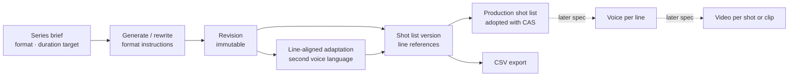

# Design Document

## Overview

This feature extends the existing script workflow; it does not add a second one. A series gains a format. The format is frozen into each revision's context snapshot, as the length target already is, and it decides which writing, review and adaptation instructions the model receives. Episodic series keep today's instructions byte for byte.

Logic lives in new pure modules. The browser imports the first three; the last two hold model instructions and are imported only by the server, so the browser bundle carries no prompts:

- `src/core/formats.ts`: format values, defaults and validation.
- `src/core/scriptLines.ts`: script-line addressing, speaker labels and line alignment between a revision and its adaptations.
- `src/core/shotList.ts`: shot-list validation, warnings, editing operations and CSV export.
- `src/core/formatPrompts.ts`: format-specific intro, writing, review and adaptation instructions.
- `src/core/storyboardPrompt.ts`: the shot-list generation request.

The server adds a `shot_lists` table, a voice-language route, four shot-list routes, and a `storyboard` model operation that reuses the writing role. The browser adds format fields to the series form, a voice-language control and a shot-list tab.

Design principles:

- **Shots point at lines.** A shot stores the first and last script line it covers, never a copy of the text. Text in every language is read from the bound revision and adaptations, so a shot list cannot drift from the script.
- **One shot plan, several voice tracks.** The second language comes from a line-aligned adaptation, so the same line references serve both languages.
- **Program checks, not model reviews.** Integrity rules reject a shot list. Timing, speaker and alignment rules produce warnings that never block.
- **Immutable versions and explicit adoption.** Every edit saves a new shot-list version. Adoption uses the same compare-and-swap pattern as script acceptance.
- **No new model role.** Shot lists use the writing role, so the deployed role assignment stays complete.



## Components and Interfaces

### Types (`src/types.ts`)

```ts
export type Format = 'vertical_short_drama' | 'episodic';
export interface DurationTarget { min: number; max: number } // whole seconds

export interface Brief {
  // existing fields unchanged
  format?: Format;                 // absent means episodic
  durationTarget?: DurationTarget; // present only for vertical short drama
}
export interface Project extends Brief {
  // existing fields unchanged
  voiceLanguages?: string[];       // series setting, not part of the frozen brief
}
export interface Episode {
  // existing fields unchanged
  productionShotListId?: string;   // absent means no adopted shot list
}

export const SHOT_SIZES = ['extreme_close_up', 'close_up', 'medium_close_up', 'medium', 'medium_wide', 'wide', 'insert'] as const;
export const CAMERA_MOVES = ['static', 'push_in', 'pull_out', 'pan', 'tilt', 'track', 'handheld'] as const;
export interface CastMember { id: string; name: string } // C1, C2, …
export interface Shot {
  id: string; sceneId: string; firstLine: number; lastLine: number;
  size: typeof SHOT_SIZES[number]; camera: typeof CAMERA_MOVES[number];
  characters: string[];                       // cast IDs in frame
  spoken: { line: number; castId: string }[]; // line positions inside this shot
  durationSeconds: number;                    // estimate, one decimal
  composition?: string; sound?: string;       // in the script language
}
export interface ShotList {
  id: string; episodeId: string; sourceRevisionId: string; parentId: string | null;
  aspectRatio: '9:16' | '16:9'; voiceLanguages: string[];
  adaptations: Record<string, string>;        // language -> localization ID
  cast: CastMember[]; shots: Shot[]; mode: ProviderMode; createdAt: string;
}
```

`ProjectBundle` gains an optional `shotLists: ShotList[]`; the server always sends it, and the type stays optional so older fixtures still type-check. `ModelRequest.kind`, `Run.kind` and `ModelAttempt.stage` gain `'storyboard'`.

Every new field is optional or lives in a new table, so stored records need no migration. New episodes are created without `productionShotListId`.

### Format presets (`src/core/formats.ts` and `src/core/formatPrompts.ts`, new)

Helpers in `formats.ts`:

- `formatOf(brief)` returns `brief.format ?? 'episodic'`. `aspectRatioOf(brief)` returns `9:16` or `16:9`.
- `parseFormat(value)` validates a format. `parseDurationTarget(value)` accepts whole seconds from 10 to 600 with `min ≤ max`.
- `DEFAULT_DURATION_TARGET` is 60–120 seconds. `MAX_SHOT_SECONDS` is 15.
- `defaultVoiceLanguages(scriptLanguage)` returns the script language, `en` and `zh-CN`, without duplicates.

Instruction builders in `formatPrompts.ts`. `studioIntro(brief, language)`, `craftGuidance(brief)` and `reviewGuidance(brief)` return today's strings unchanged for episodic briefs. For vertical short drama they return:

- an intro that names a multilingual short-drama studio instead of a sci-fi animation studio;
- `SHORT_DRAMA_CRAFT_GUIDANCE`, which keeps the genre-neutral principles of `SCRIPT_CRAFT_GUIDANCE` (causality, agency, knowledge, prop setup, continuity, playable dialogue), drops its sci-fi and robot wording, and adds the short-drama rules in Requirements 2 and 3;
- `REVIEW_GUIDANCE` followed by `SHORT_DRAMA_REVIEW_RULES`, which state that they take precedence over the general allowance for quiet endings.

Two more pieces:

- `durationInstruction(brief)` states the frozen duration target. It is empty for episodic briefs; `durationLine(brief)` adds the leading line break only when there is an instruction, so episodic prompts keep their exact bytes.
- `SHORT_DRAMA_ADAPTATION_RULES` adds the line-for-line rules of Requirement 5.3.

The short-drama line format puts every action beat and every spoken line on its own line. A spoken line reads `NAME: line` in English or `名字：台词` in Chinese, with an optional delivery note in parentheses after the name. This format keeps the line checks below reliable.

`src/core/index.ts` changes:

- `snapshotContext` copies `format` and `durationTarget` when present.
- `buildModelMessages` calls `studioIntro`, `craftGuidance`, `durationInstruction` and `reviewGuidance`.
- For short-drama adaptations, it appends `SHORT_DRAMA_ADAPTATION_RULES` and sends numbered lines for each scene.
- A new `storyboard` branch delegates to `buildStoryboardMessages`.
- The causality pass, fact extraction and audits are unchanged.

### Script lines (`src/core/scriptLines.ts`, new)

- `scriptLines(content)` splits on line breaks and keeps lines that contain non-whitespace, with trailing whitespace removed. Position 1 is the first such line.
- `inlineLabel(line)` recognizes two forms, each with an optional parenthetical after the name:
  - `NAME: text`, with an uppercase Latin name;
  - `名字：text`, with a name of 1–12 CJK letters.
- `labelOnly(line)` recognizes an uppercase name alone on a line, the layout of older scripts.
- `dialoguePositions(content)` returns lines with an inline label and the line after a label-only line. It is a heuristic and only feeds warnings.
- `requireLineAlignment(source, adaptation)` throws when any scene's script-line count differs, naming the first such scene and both counts. It runs after the existing check of scene IDs and order.
- `minimumSpeechSeconds(text, language)` strips inline labels, then divides by a fast speaking rate:
  - 3 words per second for space-separated languages;
  - 5 letters or digits per second for `zh`, `ja` and `ko`.

  Because the rates are fast, the result is a lower bound.

### Shot lists (`src/core/shotList.ts` and `src/core/storyboardPrompt.ts`, new)

**`buildStoryboardMessages(revision)`**, in `storyboardPrompt.ts`, asks for JSON `{cast, shots}`.

- The user payload holds the scenes with numbered script lines, the frozen characters text, the aspect ratio, the frozen duration target and the 15-second limit.
- The instructions require full coverage in order and line references instead of text. They ask for one speaker per shot where possible, style-neutral camera terms, and notes written in the script language.

**`parseShotList(value, revision)`** returns `{cast, shots}` or throws `ShotListError`. The error message names the failing scene, line or shot. It takes a parsed object, so model output and manual edits share one validator, and it drops unknown keys.

- **Cast**: 1–20 members. IDs are `C` followed by 1–3 digits and are unique. Names are 1–60 characters and unique ignoring case.
- **Shots**: 1–400 shots. IDs are 1–40 characters drawn from letters, digits, `_` and `-`, and are unique.
- **Each shot**:
  - names an existing scene and has `1 ≤ firstLine ≤ lastLine ≤` that scene's line count;
  - uses a known size and camera;
  - lists unique, existing cast IDs in `characters`;
  - has `spoken` entries whose lines lie inside the shot, appear only once and name existing cast IDs;
  - has a finite `durationSeconds` above 0 and at most 600, rounded to one decimal;
  - has notes of at most 500 characters.
- **Coverage**: walking scenes in revision order, each shot must start where the previous one ended. A scene's shots cover its lines without gaps or overlaps before the next scene starts. No shot may follow the last line of the last scene.

**Reading and checks:**

- `shotTexts(list, revision, adaptations)` resolves each shot's lines in every bound language.
- `shotListWarnings(list, {revision, adaptations, newest})` returns `{kind, shotId?, language?, message}` items, reading the duration target from the revision's frozen brief, for Requirement 8 and Requirements 5.7–5.8. The kinds are `too_long`, `too_short_for_speech`, `multiple_speakers`, `label_mismatch`, `unassigned_dialogue`, `dialogue_misaligned`, `total_duration`, `missing_language` and `adaptation_not_newest`.
- `shotListStatus(list, episode)` reports whether the list is the adopted production shot list and whether that adoption is current.

**Editing operations:**

- `splitShot(list, shotId, atLine)` gives the second part a new unused ID.
- `mergeWithNext(list, shotId)` joins two shots of the same scene and keeps the first ID. Every other shot keeps its ID.

**`exportShotListCsv(...)`** writes RFC 4180 CSV with a UTF-8 byte order mark.

- Columns: episode, shot-list version, source revision, adaptation IDs, production status, aspect ratio, order, shot ID, scene ID, lines, size, camera, characters, speakers, one text column per bound language, estimated seconds, duration basis (`estimate`), composition and sound.
- A cell that starts with `=`, `+`, `-`, `@`, a tab or a carriage return gets a leading apostrophe.

The server and the browser both import these functions, as the browser already does with the length check and with suggestion authorization.

### Storage and routes (`src/server/store.ts`, `src/server/app.ts`)

**Storage:**

- `Store` creates the `shot_lists` table and adds it to `Tables`. `bundle()` adds the `shotLists` whose source revision belongs to the project.
- `contextToken()` includes `format` and `durationTarget` only when present, so tokens for existing series do not change.
- The `brief()` validator accepts `format` and `durationTarget`.

**Series routes:**

- `POST /api/projects`: a missing format means episodic. For vertical short drama, the route stores the default duration target when none is sent, and sets `voiceLanguages` from `defaultVoiceLanguages`.
- `PUT /api/projects/:id`:
  - An omitted format keeps the stored one.
  - Vertical short drama keeps or defaults the duration target; episodic drops it.
  - If the script language is missing from the voice languages, the route adds it.
  - Recheck marking is unchanged.
- `PUT /api/projects/:id/voice-languages` with `{languages}` accepts 1–6 unique language tags that include the script language. The route does not touch episodes.

**Adaptation routes:** `POST /api/revisions/:id/localize` and `POST /api/localizations/:id/edit` call `requireLineAlignment` when the source revision's frozen format is vertical short drama.

**Shot-list routes:**

- `POST /api/revisions/:id/shot-lists` with `{mode}` runs the existing `model()` operation with `kind: 'storyboard'`. On success it validates the output and binds the newest line-aligned adaptation of the source revision for each other voice language. It then inserts the first version with `parentId: null`. The existing lock of one run per episode applies.
- `POST /api/shot-lists/:id/edit` with `{cast, shots, adaptations}` runs the same validation. Each bound adaptation must be a line-aligned localization of the same source revision, in one of the list's voice languages other than the script language. The route inserts a new version with `parentId` set to the edited version and `mode: 'manual'`.
- `POST /api/episodes/:id/production-shot-list` with `{shotListId, expectedShotListId}` returns 409 in four cases:
  - `expectedShotListId` differs from the stored value;
  - the list belongs to another episode;
  - its source is not the accepted revision;
  - the episode needs review.

  Otherwise it stores `productionShotListId`.
- `GET /api/shot-lists/:id/export` returns `text/csv; charset=utf-8` as an attachment.

**Model wiring:** `ProviderManager.resolve` maps `storyboard` to the writing role. `createModelCaller` gives it a resend budget of zero, as for generation.

### Demonstration (`src/server/demo.ts` and `src/server/shortDramaDemo.ts`)

The demo gets a prepared short-drama example in English and in line-aligned Simplified Chinese. It has two or three scenes, roughly 150–220 English words, written to the rules in Requirements 2 and 3.

- Demo generation returns it for vertical short-drama briefs.
- Demo adaptation returns the other language for the unmodified example.
- The demo storyboard returns a prepared shot list for the unmodified example. One set of line references serves both languages, with cast names in each language.
- Other revisions get the existing demo error.

### Browser (`web/`)

- **`app.ts`**:
  - The `Tab` type gains `shots` (分镜).
  - The series form gains a format select, which defaults to vertical short drama for new series, and duration fields in seconds that appear only for vertical short drama. The example brief follows the selected format.
  - The sidebar, the login screen and `index.html` say 编剧工作台, without 科幻.
- **`languages.ts`**: adds a voice-language checklist with its own save button, above the release settings. Its note explains the difference: release settings describe one release, while voice languages decide which tracks every episode is prepared in.
- **`shotList.ts`** (new), the shot-list tab:
  - The header has a version select, production status, an adopt button, live and demo generation buttons, and CSV export.
  - The summary shows voice-language coverage, the total estimated duration against the target, and warnings.
  - Shots are grouped by scene. Each shot is a card with a frame placeholder (`aspect-ratio: 9 / 16` or `16 / 9`) labeled with size and camera. The card also shows the covered lines in every bound language, speakers, estimated duration and notes.
  - Edit mode offers per-field inputs, split and merge, renaming or adding cast members, and the choice of bound adaptation for each language.
  - The edit draft is kept in `localStorage` under `sci-epo-shotlist:<id>` and is checked with `parseShotList` before it is restored. Saving posts the edit and removes the draft.
  - The browser recomputes warnings with the shared core functions.
- **`modelAttempts.ts` and the history view** label the new stage and run kind 分镜表.
- **`style.css`** adds shot-card styles.

All displayed values pass through `esc()`.

## Data Models

An example of a stored shot list:

```json
{
  "id": "6b0f…", "episodeId": "e1…", "sourceRevisionId": "r1…", "parentId": null,
  "aspectRatio": "9:16", "voiceLanguages": ["en", "zh-CN"], "adaptations": {"zh-CN": "l1…"},
  "cast": [{"id": "C1", "name": "MAYA"}, {"id": "C2", "name": "LEO"}],
  "shots": [
    {"id": "sh1", "sceneId": "s1", "firstLine": 1, "lastLine": 2, "size": "close_up", "camera": "push_in",
     "characters": ["C1"], "spoken": [{"line": 2, "castId": "C1"}], "durationSeconds": 4.5,
     "composition": "Maya's face fills the upper half; the phone glows below."}
  ],
  "mode": "live", "createdAt": "2026-11-07T10:00:00.000Z"
}
```

An episode keeps `acceptedRevisionId` and gains the optional `productionShotListId`. A production shot list is current when its `sourceRevisionId` equals `acceptedRevisionId` and the episode does not need review.

## Error Handling

- Model failures use the existing run records: the failure is kept, nothing is saved, and demonstration output is never substituted. Storyboard requests are not resent.
- A generated shot list that fails the integrity checks fails its run with the validator's message.
- A manual edit that fails the integrity checks returns 400 with the message, and the browser keeps the draft.
- An adaptation that is not line-aligned names the scene and both line counts. A generated one fails its run; a manual edit returns 400.
- A stale or invalid adoption returns 409 and asks the writer to refresh.
- Export never fails on content: every value is quoted and formula prefixes are neutralized.

## Testing Strategy

The repository tests every feature, and this plan follows that convention.

- **Golden prompts.** Before any prompt changes, capture `buildModelMessages` output for episodic generate, rewrite, localize, causality and review requests in `tests/fixtures/episodic-prompts.json`. A test asserts the output stays identical.
- **Core units:**
  - format parsing and defaults;
  - script lines, labels, alignment and speech estimates;
  - shot-list acceptance and each rejection rule;
  - each warning kind;
  - split and merge keeping IDs;
  - CSV quoting, the byte order mark and formula neutralization.
- **Workflow tests,** using the existing `createApp` harness:
  - defaults for new short-drama series;
  - context-token changes after format or duration edits;
  - voice-language edits that do not mark episodes for recheck;
  - line alignment enforced only for short drama;
  - shot-list generation, its failure and the demonstration path;
  - adoption, stale-tab rejection and currency;
  - export headers.
- **Provider routing.** A `storyboard` request resolves to the writing model.
- **Browser views.** The shot-list view escapes model text and renders the right aspect ratio.
- **Release checks.** Run `typecheck`, the full test suite and `build` on Windows locally and on Linux before deployment.
