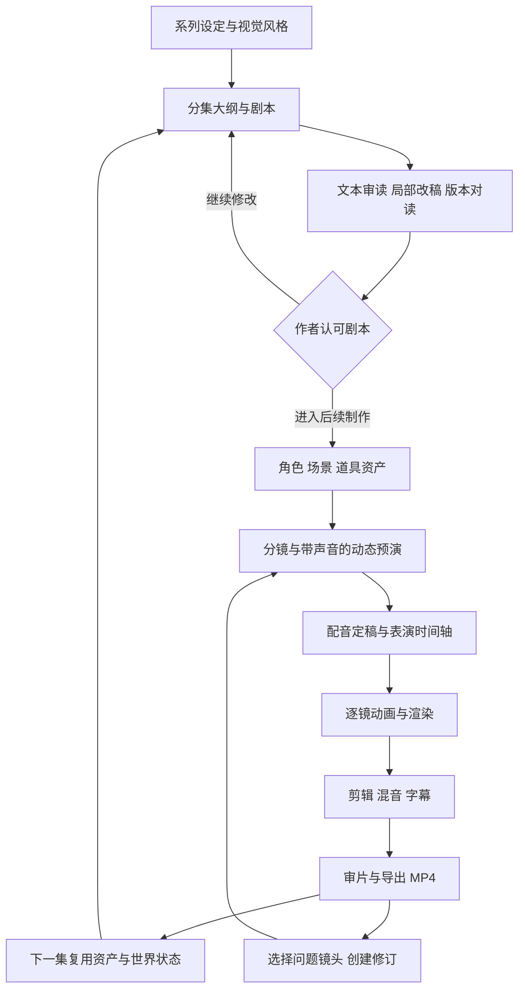

# Sci-epo · 科幻动画连续短剧制作工作台

策划版本：2026-11-05。本文保留完整制作方向；第一阶段以[剧本优先策划](script-first-plan.zh-CN.md)为准。作者明确要求先做好剧本，再考虑视频。以下动画功能均属于剧本验收后的规划，不代表已经实现。

## 产品定位

**从一个科幻点子开始，建立原创角色，写出一集剧本，完成有对白、有表演、有剪辑的动画，并能持续制作下一集。**

第一批用户是独立动画编剧、经营系列内容的创作者和小型制作团队。先完成三集可审读的剧本与改稿对照，验证故事和连载，再进入动画制作。Sci-epo 是工具名称；作品可以拥有独立的系列名称与角色品牌。

参考视频的成人科幻情景喜剧作为风格候选。具体受众、人物组合、时长和叙事方式通过创作简报及剧本试写确定；默认英文原稿和英文配音，配套中英文字幕；支持选择中文或其他语言的改编、配音及字幕发布版本。详见[多语言与发布方案](multilingual-publication.zh-CN.md)。

核心价值是：**同一批角色持续演戏，作者能修改一场戏，并清楚知道哪些画面和声音需要重做。** 原先的剧本与道具连续性检查保留，成为全流程中的一个模块。

## 参考片的启发

本次读取了作者帖文、检查原视频的七个时间点，并核对 `scifi-toon` 剧本、时间轴与配音代码。视频约 57.56 秒，仓库时间轴为 57.5 秒；未进行完整音轨听审。

剧情从买咖啡出发，用异常世界逐步升级，再以人物对咖啡因的执念收束。可借鉴的是搭档反差、小目标、荒诞升级、反应特写、停顿与结尾回扣。画面采用粗轮廓、平涂和有限动画。源码将时间轴、角色、场景、对白分开；角色动作按 12 fps 取样，摄影机和部分效果按 24 fps，嘴部由声音特征驱动。

这为可编辑的程序动画提供了参考。角色美术、分镜、表演和喜剧节奏仍需创作与打磨，已有渲染脚本不等于全自动高质量连续剧已经成立。来源：[原视频](https://x.com/lemomo_ai/status/2117809549331886091) · [scifi-toon](https://github.com/lemomo-ai/lemo-opuscar/tree/main/styles/scifi-toon) · [同类调研](research-2026-11-05.md)。

## 完整制作流程

| 环节 | 创作者的操作 | 系统产物与检查 |
| --- | --- | --- |
| 系列设定 | 定受众、幽默尺度、世界规则、人物关系和画风 | Series Bible：目标、说话习惯、世界限制、固定场景、色板；版本可锁定 |
| 编剧 | 输入本集目标，选择大纲，改对白和笑点 | 铺垫、升级、转折和收尾；记录人物、道具、时间、地点及状态变化 |
| 美术资产 | 选择造型、声音与场景 | 角色多视角、表情、嘴形、可动画部件、道具、分层背景；稳定 ID 与版本 |
| 分镜与预演 | 确认镜头目的、构图和节奏 | 镜头卡、景别、站位、动作、对白、预计时长；低清带声音预演 |
| 配音 | 试听声线，逐句调语气和停顿 | 固定 voice ID、逐句音频、实测时长、字幕时间点、嘴形数据 |
| 动画 | 调表情、动作、机位、出入画与道具交互 | 逐镜时间轴与视频；反应、视线、动作预备、结束姿势 |
| 后期 | 调顺序、间隔、音乐、音效与字幕 | 合成预览；对白清晰，笑点留出停顿，字幕不挡人物 |
| 审片与交付 | 标记问题镜头，采用新版本 | 1080p MP4、SRT、剧本、分镜表、工程包；保留旧版 |
| 连载 | 从上一集之后继续写 | 复用角色、声音、布景与已发生事件；区分临时和永久状态变化 |

优先保留三个创作确认点：剧本、动态预演、最终成片。日常微调不增加重复确认。媒体任务可在用户设定的预算和批次内连续执行。

## 工作台与关键操作

以下为视频阶段的工作区展望。第一阶段页面与交付见剧本优先策划。进入视频阶段后，每集可包含：

1. **剧本**：采用的分场、对白、动作、连续性提示；锁定场景，对照候选改稿。
2. **角色与场景**：造型、声音、姿势、背景、道具和采用版本。
3. **分镜**：顺序镜头卡；改景别、动作、对白、时长，播放预演。
4. **成片预览**：播放器和简化时间轴；选中镜头后改表演、字幕或配音。
5. **任务与导出**：进度、失败原因、重试、版本、预计与实际消耗，下载视频与工程。

核心演示操作：“保留前两场，把结尾改得更好笑”。先展示剧本差异和影响范围，检查前文道具状态，再生成第三场的新配音和动画；前两场的采用素材继续使用。新结尾变长时，更新相关拼接时间、字幕与混音。

有嘴形还不足以形成表演。视频阶段再验证眨眼、视线、抬眉、停顿、指向、拿取/放下、出入画和简单位移等动作，以及角色各自的反应习惯。

## 剧本验收后的动画技术候选

**首选：结构化剧本 + 可复用二维角色 + 程序动画 + 逐镜渲染；后续按镜头接入生成式视频。**

| 路线 | 适用范围 | 优势与代价 | 安排 |
| --- | --- | --- | --- |
| 程序二维动画 | 固定角色对白、舱室、反应特写、道具动作 | 相同资产稳定复用、时长可控；需要前期角色部件、动作库与美术模板，复杂表演仍有成本 | 剧本通过后，选一个片段验证 |
| 图生视频/视频生成 | 飞船外景、特殊生物、复杂运动 | 拓展画面与动作；一致性、口型、重试成本、接续需独立验证 | 程序动画验证后的可选后端 |
| 混合制作 | 程序角色配合审定的生成片段 | 按镜头选工具；增加色彩、线条、帧率与素材状态匹配工作 | 主路线稳定后开放 |

建议实现：

- **界面与服务**：TypeScript + React，Node 服务与持久化 worker；个人原型用 SQLite 和本地文件。在线演示采用可运行 Chromium/FFmpeg 的长驻服务和持久存储，渲染通过任务执行。
- **编剧模型**：单一可替换适配层，输出验证过的 JSON，保留提示、模型与版本。首版接一个真实可用服务，用实际剧本表现选型。
- **动画**：参考 lemo 的 `render(t)` 约定与模块划分，建立受控角色和动作组件。模型主要输出镜头/动作参数；自定义代码单独审查，在隔离环境渲染。
- **合成**：Chromium/Canvas + FFmpeg。先用 lemo 路径完成样片验证；HyperFrames 是后续渲染服务候选。视频原型只保留一个主渲染器。
- **声音**：先接一个稳定声音方案，允许上传录音。Kokoro 是参考仓库使用的候选，中文情绪表现要实际试听；使用时核对声音、模型与素材条款。
- **运行可靠性**：任务 ID、进度、取消、重试、下载；凭据存服务端；共享演示限制并发和额度。

HyperFrames、Remotion、Motion Canvas 属于视频基础设施；Toonflow、Moyin Creator、LTX Studio 更适合参考完整创作交互。详见调研，不在视频原型中同时接入。

### 工程数据与修订

结构：`Series → Episode → Scene → Shot → Take → Export`。Character、Location、Prop、Voice、AudioClip 是可复用资产。

采用版本记录稳定 ID、内容版本、引用资产版本、上游版本、生成参数、产物位置/哈希、状态和采用决定。镜头包含对白、动作、开始/结束状态、实际音频时长。失败的临时文件不能标为可交付。

- 改台词：更新对应声音、嘴形、镜头时长及相关字幕/混音。
- 改角色造型：列出引用该版本的镜头；旧版本保留可回放。
- 改道具状态：检查相关后续场景；自动计数只覆盖显式结构化动作，语义遗漏归人工复核。
- 改标题：只更新相关片头或片尾。
- 任务超时：先查询供应商任务状态，再决定重试，避免重复生成与计费。

## 原创系列候选

暂定 **《轨道杂务局》/ Orbital Odd Jobs**：空间站有夸张科技，却仍被送货、排队、报销和生日这样的小事困住。

- **Pip**：乐观、爱即兴解决问题的快递机器人，沿用已有原创试播集。
- **No.7**：执着于流程的站务终端；造型、声线和节奏与 Pip 拉开差异。本次新增提案，尚未定稿。
- **布景**：零重力邮务间、交付舱门/服务台。
- **故事机制**：日常目标 + 一条科幻限制 + 不同解决方法 + 伏笔回收。

| 集数提案 | 故事 | 验证能力 |
| --- | --- | --- |
| EP01《最后一次喷射》 | 只有一次喷射机会，却要把蛋糕送到；投出开场盒盖，靠反冲返回 | 75 秒故事、道具消耗、动作落点、结尾修改 |
| EP02《迟到三十秒》 | 想准时打卡；时间机器只退回 30 秒，登记记录却保留 | 人物布景复用、对白笑点、事件状态 |
| EP03《失物招领》 | 找报销凭证；柜子按“主人最想忘记的程度”给失物排序 | 角色性格延续、道具库、局部新资产 |

EP01 增加 No.7 或改笑点时创建新版，保留原作与连续性测试。后两集仅为提案，剧本阶段补齐规则。

## 后续视频原型范围与验收

剧本验收后可选择一套画风和一小段已定稿文本，限制角色、场景及镜头数量来验证动画实现。原先的 60–90 秒、两角色、两场景只作为技术实验候选，不反向决定故事形式。视频原型再提供逐镜预览、局部渲染和 MP4 导出。

后续：更长剧集、多集排产、更多角色、生成外景、多语言、团队审片、计费和发布。竖屏需要独立构图与字幕安全区验证。

| 验收项 | 通过标准 |
| --- | --- |
| 视觉可行性 | 15 秒中角色跨景别身份一致，能看出说话人，反应和笑点可读；用户审片后再扩整集 |
| 完整流程 | 从已审定剧本实际产出可下载、可播放的 MP4，长度按该次制作简报；预置示例单独标明 |
| 资产复用 | 至少六镜引用同一版本角色/声音；第二段 15 秒复用它们验证跨集能力 |
| 修改可信 | 改第三场后前两场文本、资产引用与采用视频哈希不变；只渲染受影响镜头，再合成全片 |
| 连续性 | 第二次喷射定位到资源耗尽的场景；盒盖方案通过该显式规则，未覆盖项如实标记 |
| 声画质量 | 无意外黑屏、漏字、字幕越界或截音；检查口型、停顿、说话人与笑点，整片实听实看 |
| 失败恢复 | 中断后可恢复，成功镜头可复用；无产物的任务不能显示完成 |
| 成本记录 | 含每次调用、失败重试、渲染和人工修改时间；按被采用的成片分钟核算 |
| 在线使用 | 新浏览器会话能走完一条实际制作/修改路径并下载可播放视频 |

性能指标在 15 秒实验后定值。当前不承诺固定单集费用或“几分钟出一集”。

## 开发顺序（已按剧本优先调整）

原先以 15 秒动画和固定日期出片为起点的排期已撤销，改为以下质量检查点。

| 阶段 | 交付 | 检查点 |
| --- | --- | --- |
| 剧本基线 | 创作简报、完整试播稿、审读标准与版本对照 | 作者认可故事方向和改稿依据 |
| 编剧原型 | 策划、写作、审稿、局部改稿、版本保存与导出 | 新输入能实际完成写改审流程 |
| 连载验证 | 三集剧本、历史资料、定稿记忆和后续复核 | 人物与故事可延续，旧集修订不泄漏未来信息 |
| 文本产品交付 | 可用编剧工作台与真实开发记录 | 按实际功能演示和提交 |
| 后续影视转化 | 定稿剧本的分镜、读演、预演与动画实验 | 逐步验证，尚不承诺固定出片日期 |

第一项工作改为 **系列创作简报、试播剧本和可对读的审稿/修改基线**，详见[当前策划](script-first-plan.zh-CN.md)。

## Kiro、仓库与参赛材料

Kiro 用于开发软件；编剧模型、声音和渲染器是软件的运行时组件。两者分别说明。

0.4.6 及以前的版本没有使用 Kiro。0.5.0 起用 Kiro 的 spec 和 steering 开发，第一份 spec 是 `.kiro/specs/vertical-short-drama/`。参赛说明只写实际使用过的功能。

分类按实际实现的编剧应用复核，未接入的动画模块不写为参赛能力。复用组件名称、固定版本、改动与素材来源写入 pre-existing work；研究过的项目与真正采用的依赖分开登记。

官方当前要求实际工作应用、公开 GitHub 与可识别开源许可证、根目录 `.kiro/`、Kiro 使用说明，以及三分钟内的公开 YouTube 演示。截止 **2026-12-05 06:00 台北时间**。[官方 FAQ](https://kiroween.devpost.com/details/faqs) · [规则](https://kiroween.devpost.com/rules)。

2026-11-10 起在公开仓库 `zhang001ziyu/sci-epo` 开发，完整可运行源码、必要素材与 `.kiro/` 都在这里；私人部署的运维记录不放进公开仓库。公开版本运行不能依赖评委无权访问的私有代码。此前的进展 MP4 不能替代最终产品演示。

## 商业验证与当前状态

先自己完成三集剧本，再邀请连载创作者试用。当前记录故事采用情况、读者意见、修改轮数、真实改善与失败；进入视频后再增加资产复用和成片成本指标。

单集成本 = 编剧/改稿 + 新资产制作 + 配音 + 生成片段及失败重试 + 渲染/存储 + 人工审片。取得数据后再定价，可考虑工作台订阅与媒体消耗分开。内容频道验证故事与受众，工作台复用率验证软件价值。

已有：策划与公开基础仓库、原始剧本/JSON、Kiro 准备文件、开发进展演示、竞品调研，以及 AINovel 复用评估。下一阶段是剧本试写、审读、改稿和编剧应用；动画实验排在剧本采用之后。

完整应用尚未实现。当前先用文本和读稿验证内容质量，后续再验证动画成本与成片质量。
