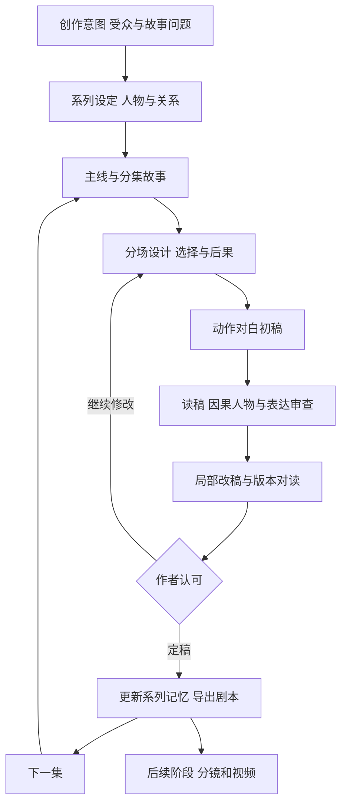

# Sci-epo · 剧本优先的开发策划

> 2026-11-06 实施更新：首个本地编剧工作流已实现，当前功能见 [README](../README.md)。本文保留 11 月 5 日的策划/核查时点。
版本：2026-11-05，依据作者最新要求修订。本文是当前第一阶段的产品与开发依据；[完整制作方向](production-plan.zh-CN.md)保留为长期路线。

## 方向与优先级

**先把科幻动画剧本做好，再进入视频生产。** Sci-epo 第一阶段是一间可持续创作、审读和改稿的编剧工作室。它要继承 AINovel 的长篇策划、人物与世界记忆、去 AI 腔研究和版本审稿经验，再补上影视剧本需要的场面、对白、潜台词和可表演动作。

首版的完成标志是作者愿意采用的剧本、可核对的改稿过程，以及同一系列能够继续写下去。MP4、角色绑骨、视频模型和渲染队列放到后续阶段。

上一版的“先做 15 秒动画样片”不再是第一项开发任务。60–90 秒、三场戏、两位角色、两个场景也不作为产品硬限制；现有 75 秒样例只是一份连续性练习。剧集时长、人物数量、幽默尺度和连载形式由创作方案确定。参考片的情景喜剧可以作为风格候选，科幻冒险、悬疑或带情感落点的故事同样保留空间。

2026-11-06 作者更新：原稿与首版配音默认英文；字幕包含中英文。中文及其他语言配音从数据结构开始支持，发布时分别选择原稿／改编语言、配音语言、字幕语言与显示方式。作者操作界面与审稿说明目前使用中文。详见[多语言与发布方案](multilingual-publication.zh-CN.md)。

## 从 AINovel 继承的核心

本次只读检查了 AINovel 的实际源码、质量方案和历史实验报告；实际复用的代码见[复用清单](reuse-manifest.md)。

| AINovel 积累 | Sci-epo 的具体用法 |
| --- | --- |
| 人物目标、底线、关系与说话习惯 | 人物想要什么、害怕失去什么，为什么在此时这样说、这样做；配角也能改变局面 |
| 世界规则、物品/能力消耗、信息边界 | 科幻装置影响选择并承担代价；作者知道、观众知道、人物知道分别记录 |
| 长篇大纲、阶段兑现与未完事件 | 系列主线、分集故事、关系变化、铺垫和回收；本集可完整结束，后续仍有发展空间 |
| 场景级上下文与历史版本 | 按故事当时的设定写/改本集，不把后集秘密泄回前集 |
| 写作与修改约束 | 优先修因果、动机和场面，再处理对白和表达；作者认可的段落和事实可锁定 |
| 双向证据审稿、版本对读 | 每条问题指向设定依据与当前台词/动作；保留原稿、候选、采用理由与分歧 |
| 定稿后进入记忆 | 未采用的候选不变成系列事实；修改早期定稿后提示后续相关场景复核 |

复用的是有证据的机制和方法。AINovel 的历史实验既有改善也有退步，不能直接宣布迁移后剧本质量已经合格。当前仍属方案的规则，不能写成已上线能力。

## 创作流程

### 创作意图先于设定堆砌

创作简报只问会影响故事的事情：希望观众在乎谁、经历什么情绪、想看怎样的处境和关系；作品允许多荒诞、哪些内容不想写。科幻设定回答“它怎样改变人的选择”，不要仅列技术名词。

系列设定保存人物欲望、底线、欠下的事、利益关系、互相隐瞒的信息和独特说话习惯。人物卡中的“冷静”“活泼”需要具体到接话、回避、讨价还价或沉默的方式；也允许人在不同关系中呈现不同一面。

### 先设计戏，再写台词

每场先明确：谁想改变什么，遇到什么阻力，采取了什么办法，另一人怎样回应，最后处境发生了什么变化。它们是策划问题，不强迫每场都填同一套节拍。日常闲谈、安静收束、没有反转的场景同样可以成立。

分集安排先看人物行动和事件后果，再看铺垫与回收。喜剧可用误解、立场反差、延迟反应和意外兑现；不把每句话都加工成段子。观众需要跟得上角色真正关心的事情。

### 从小说表达转成可表演的剧本

保留小说中的人物深度与因果积累，把需要让观众知道的信息转为可见动作、对白、声音、场面变化或有明确用途的旁白。不能只给小说段落加人名，也不把内心活动全部塞进解释性对白。

剧本阅读页保持清晰的场景、动作、人物与对白；审稿依据和结构字段放在旁侧。编剧阶段不要求先填完整镜头参数或模型提示词。旁白、内心独白、蒙太奇和故意重复都是可选表达方式，按作品风格评估。

## 去 AI 味具体处理什么

去 AI 味围绕具体阅读问题工作。词频、句长和检测器分数不能作为“像人写的”或“值得观看”的证明。

| 问题 | 审读时找什么证据 | 修改方向 |
| --- | --- | --- |
| 重复解释 | 动作已经呈现，旁白或对白又重述一次；删掉后是否丢失信息或节奏功能 | 保留有效呈现，删减无新增作用的解释；有意回环可保留 |
| 人物同声 | 换说话人后几乎不影响表达与反应 | 回到关系、立场、知识和说话策略，不只换口头禅 |
| 设定宣讲 | 人物互讲双方早已知道的规则，观众只收到说明 | 让规则在冲突、误用、交易或失败中被看见；必要说明仍可简洁保留 |
| 情绪空泛 | 文本宣称紧张、感动、信任，却缺少对应选择或变化 | 写出具体反应、犹豫、隐瞒、行动或承担；不机械禁用情绪词 |
| 模板化转折 | 每场都“更大危机”，反转与人物选择无关 | 回到已有因果与兑现，允许局部成功和完整收束 |
| 角色替作者说话 | 对白替观众总结主题、人人表达同一种道理 | 用不同立场和后果让主题成立，留下判断空间 |
| 科幻设定方便解围 | 临时增加能力、恢复资源或补规则，使前文冲突失效 | 回用已建立的条件，或回到结构层重新铺垫并审核影响 |

例如机器人角色可以故意使用程式化措辞，这是角色设计；“机器腔”不能在所有语境一律判错。对白自然也不等于每句话都有强冲突，招呼、迟疑、打断、重复和没说完的话都有其用途。

## 审稿与改稿机制

分三轮看，避免把所有问题混成一次“润色”：

1. **故事与人物**：前提是否值得展开；选择是否有来由；人物是否改变局面；结尾有没有兑现本集承诺。
2. **场面与表达**：动作能否理解、对白能否说出口，信息有没有重复，停顿/潜台词/反应是否有效。
3. **连续性与作者约束**：事实、角色知情、时间、持物、能力、关系与前后场是否一致，锁定内容是否保留。

输出类型分别显示：确定的结构/事实冲突、需要补证据的问题、可接受或拒绝的审美建议、未执行检查。每条意见包含原文位置、所依赖的设定或前文、影响、最小修改范围。引用存在只证明可追溯，作者仍可质疑判断。

先给修改方案和影响范围，再生成候选。原稿保留；默认一次聚焦一个主要问题。候选若只让词表更干净、却破坏人物或因果，应拒绝。没有改善、评委分歧与输出失败都进入记录，不能反复整稿循环直到自评分变高。

人物弧线或核心因果有问题时允许回改大纲；这类大改应单独标明，不能包装成“不改变剧情的润色”。作者明确采用后才更新系列事实，后续场景按依赖提示重审。

## 第一版软件范围

第一阶段做六件事：

1. 创作简报与系列资料：作者规则、人物、世界、关系、秘密与事件历史。
2. 主线/分集/分场策划：支持原创输入与作者指定文本，保留来源。
3. 剧本初稿与编辑：所选原稿语言的动作/对白，支持锁定和局部修改。
4. 证据审稿：事实、信息边界与去 AI 腔建议分开展示，真实未检查如实标明。
5. 多版本对读与作者定稿：差异、采用理由、历史资料快照和下游失效提示。
6. 导出：可独立阅读的 Markdown/TXT 剧本、人物/世界设定、分场表和审稿记录；为后续视频提供结构化数据。

基础结构：`Series → Arc → Episode → Scene → ScriptRevision`，另有版本化 Character、WorldRule、Knowledge、Event 与 Review。Shot/Voice/Take 在后续视频阶段扩展。用户写作时看到的是戏，不要求操纵这些实现字段。

技术上先提炼 AINovel 的上下文、历史快照、作者约束和审稿接口，建立独立原型。暂不复制整个商业平台，不与现有生产书库耦合。小说正文输出、排版协议和审美阈值需要按剧本重写，不能原样接上。是否直接移植具体模块，另做源码依赖与公开范围核对。

## 剧本质量如何验收

### 第一批材料

先做一份系列创作简报、若干故事方案，选一个写完整试播剧本，再写两集延续故事。三集是验证材料的数量，不限制产品集数。现有《最后一次喷射》保留为机制样例；《轨道杂务局》和 No.7 保留为可比较的创作提案。

现有样例能够演示燃料消耗和伏笔回用，但还需要回答：Pip 为何在乎这次生日投递？摄像头为何拿自己的照片检查放行？这个笑点来自谁的性格、是否需要额外解释？这些是本次读稿提出的问题，不能用燃料校验通过替代。

### 对照方法

- 先固定作者意图、人物事实和输入，保存原稿与候选；同一轮改动范围明确。
- 既看熟悉样例，也留未见输入，包含安静收束、日常对白和故意机器腔等反例。
- 用匿名 A/B 对读和朗读检验，调换版本顺序；记录读者偏好及具体片段，不只取总分。
- AI 评审作为辅助意见，使用独立评审上下文；两次同模型结果不等于两位真人意见。真人读者尚未参与时明确写出。
- 保存全部尝试、截断、失败、分歧和退步；相同模型/输入的随机波动不能当作某条提示词有效的证据。

### 进入视频阶段的条件

| 维度 | 要得到的证据 |
| --- | --- |
| 故事 | 作者能明确认可这一集的核心看点、人物选择和结尾；看点能在剧本文本中成立 |
| 人物 | 主要角色的立场和反应有区别；配角提出的条件没有在转场中被遗忘 |
| 对白 | 朗读不需要补大量解释；重复、停顿和说明有明确用途；保留读者实际意见 |
| 科幻因果 | 规则影响行动和代价；未解决的事实冲突被标出并处理，缺证据不冒充通过 |
| 连载 | 后两集延续已采用的人物与事件；旧集改稿不会知道未来秘密 |
| 修改 | 至少一次有范围、有理由、可对读的实质改善；未修改部分和作者锁定内容保持 |
| 定稿 | 作者逐篇采用，未采用候选不入正式记忆；还有分歧的地方按实际记录 |

这是创作验收，不承诺一个自动分数能代替作者判断。三篇剧本也只验证初步方向，后续还需更长连载和不同输入的稳定性验证。

## 调整后的开发顺序

| 阶段 | 交付 | 下一阶段的依据 |
| --- | --- | --- |
| 1：创作与评估基线 | 系列简报、故事方案、完整试播稿、审读量规、对照记录 | 作者认可要写什么，以及怎样判定改稿有效 |
| 2：剧本原型 | 策划、写作、证据审稿、局部修改与版本对读 | 新输入能实际走完写改审流程 |
| 3：连载验证 | 三集剧本、定稿记忆、历史回改与后续复核 | 人物/世界可延续，修改不污染其他版本 |
| 4：可用的编剧工作台 | 项目保存、导出、真实状态与失败恢复；实际 Kiro 开发记录 | 作者能独立用它完成一集并采用 |
| 5：影视转化 | 从已定稿文本做分镜和低成本读演/预演 | 场面与节奏通过，再决定角色动画和视频路线 |

日期服从质量检查点，不沿用“固定日期必须出 MP4”的旧排期。参赛材料按实际完成的编剧应用填写和演示；参赛录屏是软件演示，生成动画是产品后续能力，两者区别写清。Kiro 功能只记录真实使用。

当前完成的是策划调整和 AINovel 复用评估。本轮没有修改 AINovel、调用其付费模型、改动书库或完成新剧本质量实验。
